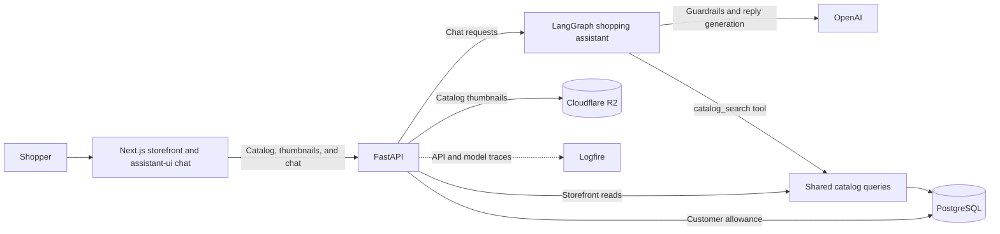
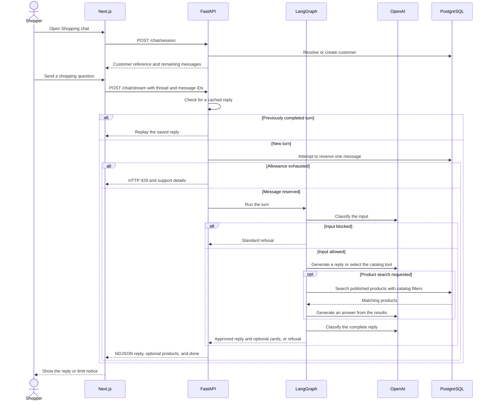

# Ecomm Assistant

An AI shopping assistant for a clothing storefront. Shoppers can ask what fits their size, style, or budget, refine the request in a follow-up, and open matching product pages from cards inside the chat.

[Try it locally](#quick-start) · [Chatbot architecture](#chatbot-architecture) · [Backend guide](backend/README.md) · [Frontend guide](frontend/README.md)

## How shoppers use it

Open **Shopping chat** from the homepage or a catalog page and ask, “Show me men’s T-shirts under $25 that are in stock.” Then ask, “What about navy in medium?” The assistant uses the previous turn to interpret the follow-up and searches the published catalog for the updated criteria. When it finds matches, the reply can include up to eight cards with product names, prices, availability, photos when available, and links to the detail pages.

Shoppers can also browse the storefront directly. The catalog supports keyword search, size and color filters, price ranges, stock filters, sorting, and product galleries.

## System architecture



| Component | Responsibility |
| --- | --- |
| [Next.js and assistant-ui](frontend/) | Render the storefront and chat, forward requests to FastAPI, and use the same product card in chat and catalog results. OpenNext packages the frontend for Cloudflare Workers. |
| [FastAPI](backend/main.py) | Serves chat, session, catalog, media, and health endpoints. It manages chat identity and allowance before handing a message to the agent. |
| [LangGraph and OpenAI](backend/chatbot/) | Run input and output checks, interpret the shopper’s request, call the catalog tool when needed, and hold conversation history in process. The default model is `gpt-4.1-mini`. |
| [PostgreSQL, SQLModel, and Alembic](backend/models.py) | Store products, categories, size and color variants, stock quantities, image metadata, storage locations, and chat usage. Alembic manages schema changes. |
| [Cloudflare R2](backend/catalog/storage.py) | Stores image originals and generated WebP thumbnails. Thumbnail URLs use the API through Next.js by default and can use a configured CDN. |
| [Logfire](backend/main.py) | Traces FastAPI requests and OpenAI calls and records guardrail decisions and model failures. |

## Chatbot architecture



1. **Identify the customer and thread.** Opening the panel calls `POST /api/chat/session`. FastAPI issues or recognizes the customer cookie, stores its token hash in PostgreSQL, and returns a customer reference and remaining allowance. A thread UUID identifies the conversation within that customer’s session.
2. **Reserve a turn and check intent.** On a new message, FastAPI atomically reserves one of the customer’s 20 default slots. The input guardrail classifies the latest message before the agent sees it. The shopping prompt handles ordinary greetings, directs product requests to the catalog tool, and provides a standard refusal for unrelated requests.
3. **Retrieve product facts.** The model can call `catalog_search` with a full or partial title, keywords, audience, clothing type, size, color, price range, stock status, and sort order. The tool runs the same SQL search as the storefront. Size, color, and stock constraints apply to the same enabled variant when requested together. The tool provides compact product facts for the final model call and structured product summaries for the UI.
4. **Check the reply and deliver it.** The output guardrail checks the complete reply for issues such as disclosure of internal instructions or unauthorized promises. A blocked turn returns the standard refusal and omits product cards. FastAPI sends the complete approved text or refusal in a `delta` event, then optional `products` and a final `done`. The response is newline-delimited JSON (NDJSON). The browser can stop an in-flight reply.
5. **Keep approved context for follow-ups.** LangGraph stores approved, nonempty turns in memory, keyed by customer and thread. Closing and reopening the panel on the loaded page preserves the conversation. A page reload starts a new thread, and an API restart clears in-process history. PostgreSQL retains the allowance across both events. A completed response can be replayed with the same message ID while its thread remains in memory.

## Catalog and operations

Staff use the catalog CLI to create drafts, assign categories, manage variants, upload photos, and publish products. PostgreSQL records publication and image state. The CLI verifies image uploads and generates WebP thumbnails for storefront delivery. A Compose maintenance service can clean up retired media and reconcile storage against the database.

[Catalog operations and demo data](backend/README.md#manage-the-clothing-catalog) · [Chat API and quota operations](backend/README.md#shopping-chat) · [CI workflow](.github/workflows/ci.yml)

## Quick start

From the repository root, copy [the backend environment example](backend/.env.example) to `backend/.env` and set `OPENAI_API_KEY` to enable chat. Then start the database and API with Docker Compose.

```sh
docker compose up --build --wait
curl -fsS http://127.0.0.1:8000/health/db
```

In another terminal, run the storefront.

```sh
cd frontend
pnpm install --frozen-lockfile
pnpm dev
```

Open the [storefront](http://localhost:3000) and select **Shopping chat** in the bottom-right corner. Publish a product or load the demo fixture to try product recommendations. [Demo catalog setup](backend/README.md#seed-the-local-demo-catalog) · [FastAPI interactive docs](http://127.0.0.1:8000/docs)
